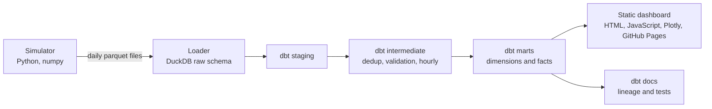

# Plant telemetry analytics

An analytics engineering project built around a problem I know from my work: sensor data from
industrial plants. Raw historian-style exports go in, tested and documented tables come out, and
a static dashboard is published every morning.

- Dashboard: https://jimmytrmt.github.io/Plant_Telemetry_Analytics/
- dbt documentation and lineage: https://jimmytrmt.github.io/Plant_Telemetry_Analytics/dbt-docs/

The data is synthetic. Four fictional plants (France, Germany, United Kingdom, Thailand) produce
eight tags each. The simulator is deterministic and injects the defects that real telemetry has:
missing samples, communication outages, bad quality flags, sentinel values such as -9999, spikes,
duplicated rows and stuck sensors. The transformation layer has to deal with all of them.

## What the dashboard shows

The site has four pages. The first three cover one topic each, the last one explains the rest.

| Page | Covers | What you see |
| --- | --- | --- |
| Overview | Production and how well the fleet ran | Five headline figures, daily energy per plant, a scorecard with availability and capacity factor |
| Operations | When and for how long each plant stopped | A day-by-day availability grid, a timeline of stops, a log of every stop with its type |
| Data quality | Whether the numbers can be trusted | Share of expected samples that arrived, share rejected per measurement, stuck sensors |
| About | What the figures mean | How the data gets there, a definition of every figure and the table it comes from |

Each page opens with one sentence that reads the current selection, and a "How to read this page"
panel that defines the terms used on it. The period (7, 14 or 30 days) and the plant buttons at
the top filter every figure on the page, the choice is kept when you change page, and Reset
brings everything back. The moon and sun button switches between light and dark, tables download
as CSV, and the scorecard sorts on any column.

The figures are computed in the browser from a small block of JSON embedded in each page. That
is what makes the filters instant without a server. The JSON comes from the dbt marts, so the
page and the warehouse cannot disagree.

## Architecture



Everything runs on free tooling: DuckDB is a single file, GitHub Actions runs the pipeline, and
GitHub Pages serves static HTML. There is no server to keep alive.

## Data model

| Layer | Models |
| --- | --- |
| Staging | `stg_readings`, `stg_sites`, `stg_tags` |
| Intermediate | `int_readings_deduplicated`, `int_readings_validated`, `int_readings_hourly`, `int_site_hourly_status` |
| Core marts | `dim_sites`, `dim_tags`, `fct_readings_hourly` (incremental) |
| Analytics marts | `fct_tag_daily_stats`, `fct_site_daily_kpis`, `fct_downtime_events`, `fct_sensor_flatlines` |

A few modelling choices worth reading in the code:

- **Deduplication** keeps one row per tag and timestamp, best quality first, then the latest load.
- **Validation** gives every reading a verdict (`valid`, `missing_value`, `bad_quality`,
  `sentinel_value`, `out_of_range`) using limits from the tag catalog, so adding a tag is a seed
  change.
- **Local dates.** Daily KPIs use each plant's own timezone, and a day only counts as complete
  when the hourly grid covers its first and last local hour.
- **Downtime events** come from a gaps and islands query over the hourly status grid.
- **Alarm exceedances** use the hourly mean, because emission limits apply to averaged values.
- **Late data.** `fct_readings_hourly` is incremental with a lookback window, so files that arrive
  late correct hours that were already processed.

## Data quality

`dbt build` runs more than sixty checks on every pipeline run:

- generic tests (`unique`, `not_null`, `relationships`, `accepted_values`) plus two custom ones,
  `between_values` and `unique_combination`;
- model contracts on the dimensions and on `fct_site_daily_kpis`;
- singular tests that reconcile daily energy with the hourly table, forbid overlapping downtime
  events and check that deduplication holds;
- unit tests for the deduplication rule, the validation rules and the downtime grouping logic.

The Python side has its own tests: deterministic simulation, idempotent loading (a changed file
replaces its rows, an unchanged file is skipped), the command line and dashboard rendering.

## Run it locally

Python 3.10 or newer is required.

```powershell
py -3.12 -m venv .venv
.venv\Scripts\Activate.ps1
pip install -e ".[dev]"
telemetry run --days 45 --docs
telemetry dashboard
telemetry serve
```

On Linux or macOS, activate with `source .venv/bin/activate`.

| Command | What it does |
| --- | --- |
| `telemetry simulate --days 45` | Writes one parquet file per day under `data/raw/readings` |
| `telemetry ingest` | Loads new or changed files into `warehouse/telemetry.duckdb` |
| `telemetry transform --docs` | Runs `dbt build`, optionally generates the dbt docs |
| `telemetry run` | The three steps above in order |
| `telemetry dashboard` | Builds the static site in `site/`, with the dbt docs if they were generated |
| `telemetry serve` | Serves `site/` on http://127.0.0.1:8000 |

Open http://127.0.0.1:8000 after `telemetry serve`. The dashboard pages also open straight from
`site/index.html`, but the dbt docs load JSON files and browsers block that on `file://`, so the
"dbt docs" button only works through the local server. The "Source code" button appears only when
the build knows the repository: GitHub Actions provides it, and locally you can set
`TELEMETRY_REPOSITORY_URL` to show it.

## Repository layout

```
dbt/                     dbt project (models, seeds, macros, tests)
src/telemetry_pipeline/
    simulation/          plant model, event calendars, fault injection
    ingestion/           idempotent parquet to DuckDB loader
    dashboard/           queries, page templates, scripts and styles of the static site
    cli.py               the `telemetry` command
tests/                   pytest suite
docs/decisions.md        why the project is built this way
.github/workflows/       CI and daily dashboard publication
```

## CI and publication

- `ci.yml` lints with ruff, type checks with mypy, runs pytest with an 80 % coverage floor, then
  runs the whole pipeline on a fixed 21 day window so a failing dbt test blocks the merge. A
  separate job runs bandit on the Python code, pip-audit on the dependencies and zizmor on the
  workflows themselves.
- `dashboard.yml` runs every morning at 05:17 UTC and on each push to `main`. It regenerates the
  data, runs dbt with its tests, builds the dashboard with the dbt docs and the repository link,
  and deploys to GitHub Pages. The site stays online if the schedule stops, it only stops refreshing.

To publish your own copy, push the repository to GitHub, open Settings, Pages, and choose
GitHub Actions as the source.

## Limits

The simulator is a plausible model, not a calibrated one. DuckDB allows a single writer, which is
fine for a daily batch and would not be for concurrent loads. Spikes that stay inside the valid
range are not caught by the range check.
